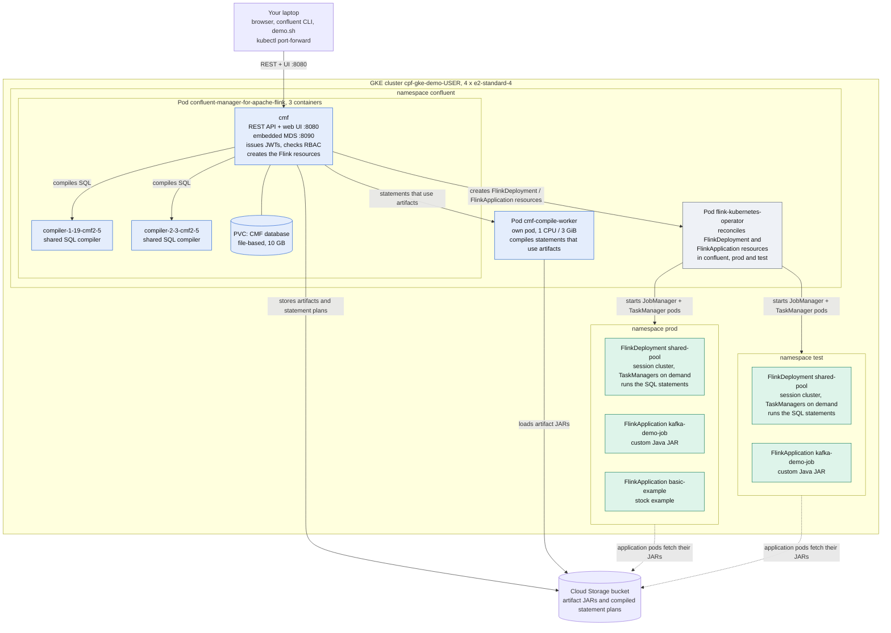
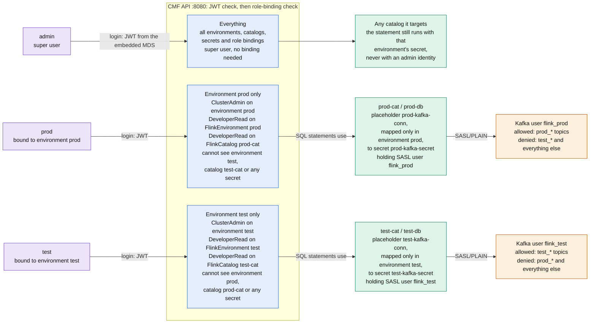
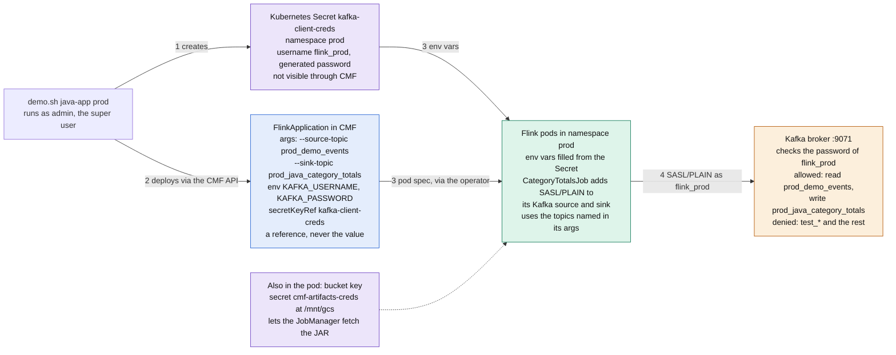

# CPF demo environment: architecture and security

This document describes the environment that `demo.sh` builds: Confluent Manager for
Apache Flink (CMF) 2.5 on Kubernetes, running Flink SQL statements and a custom Java job in
two isolated environments, `prod` and `test`, against a secured Kafka cluster. It was
verified on a live GKE cluster on 2026-11-12.

In commands, `<user>` is the name you pass to `--user`. It becomes part of the cluster and
bucket names, for example `cpf-gke-demo-<user>` and `cpf-artifacts-<user>`.

- [Architecture: what runs where](#architecture-what-runs-where)
- [What the demo runs](#what-the-demo-runs)
- [Security](#security)
- [Flink application security](#flink-application-security)
- [CMF security options](#cmf-security-options)
- [Operating it](#operating-it)
- [Limits and what is not verified](#limits-and-what-is-not-verified)
- [Sources](#sources)

## Architecture: what runs where

Everything runs in one GKE cluster. CMF, its compile worker and the Flink Kubernetes
Operator live in the `confluent` namespace. Each Flink environment is a namespace of its own
(`prod`, `test`) that CMF fills with Flink clusters through the operator. The laptop reaches
CMF through a `kubectl port-forward`.



CMF is the only thing the laptop talks to. Its pod compiles ordinary SQL with two shared
compilers; statements that use artifacts go to the separate compile worker, and both read
artifacts from the bucket. CMF never starts Flink pods itself: it writes `FlinkDeployment`
and `FlinkApplication` resources into the environment's namespace, and the Flink Kubernetes
Operator turns them into JobManager and TaskManager pods. The Kafka cluster is outside this
picture; the [Security](#security) section shows how the Flink pods reach it.

### Components

| Component | Runs as | Role | Notes |
|---|---|---|---|
| `cmf` | container in the CMF pod | REST API and web UI. Owns environments, catalogs, compute pools, statements, applications, secrets and role bindings. Hosts the embedded MDS that issues login tokens. | State is in a file-based database on a PVC. `helm uninstall cmf` deletes it. |
| `compiler-*` (two) | containers in the CMF pod | Shared SQL compilers. CMF 2.5 compiles a statement once, when it is created. | New in 2.5. About 1 CPU and 2 GiB each. |
| `cmf-compile-worker` | separate pod (`worker-0`) | Compiles statements that use artifacts (UDFs, custom connectors). It is the only place that loads user JARs. | Created because artifacts and the environment catalog are both on. 1 CPU and 3 GiB. |
| `flink-kubernetes-operator` | deployment, 2 containers | Reconciles `FlinkDeployment` and `FlinkApplication` into Flink clusters. Watches `confluent`, `prod` and `test`. | Needs cert-manager (namespace `cert-manager`) for its webhook. |
| Compute pools | CMF resources | `shared-pool` is a long-lived session cluster for DDL, ad hoc queries and the streaming job. `pool` is DEDICATED: its own cluster per statement. | Bounded jobs belong on the dedicated pool, or need an explicit wait for completion. |
| Cloud Storage bucket | outside the cluster | CMF artifact storage. The bucket service account's key is in the Kubernetes secret `cmf-artifacts-creds`, copied into each environment namespace for the Flink pods. | Created by `demo.sh artifacts`, removed by `down`. |

The Confluent Platform Kafka stack (KRaft controller, broker, Schema Registry, Control
Center, managed by the `confluent-operator` pod) runs in the same `confluent` namespace. It
is a single broker with replication factor 1 and topic auto-creation off, and it is not part
of the CMF picture above.

### How a request moves

1. **Run a SQL statement.** The client calls CMF with a token. CMF checks the role binding,
   picks a compiler (shared, or the worker if artifacts are involved), compiles the statement
   once, and submits the job to the environment's session cluster, `shared-pool`. The
   TaskManager that runs it connects to Kafka as that environment's user.
2. **Deploy a Java application.** The JAR is uploaded to CMF, which stores it in the bucket.
   CMF creates a `FlinkApplication`. The operator starts a JobManager that fetches the JAR
   from the bucket and runs `CategoryTotalsJob`.
3. **First job on a cold pool.** The session cluster has only a JobManager. The first
   statement makes it request a TaskManager pod, which can take more than a minute. When no
   node has CPU left the pod stays `Pending`, which is why the cluster has four nodes.

## What the demo runs

| Environment | SQL | Java | Kafka topics | Catalog |
|---|---|---|---|---|
| `prod` | `streaming-aggregation` (30 s tumbling windows, `prod_demo_events` to `prod_demo_aggregated`) | `kafka-demo-job`: per-category totals into `prod_java_category_totals`; `basic-example` | `prod_*` | `prod-cat` / `prod-db` |
| `test` | `streaming-aggregation` on `test_demo_events` to `test_demo_aggregated` | `kafka-demo-job` into `test_java_category_totals` | `test_*` | `test-cat` / `test-db` |

The Java job is in [`app/kafka-demo-job`](../app/kafka-demo-job).

## Security

Two layers, each with its own identities. **CMF** decides who may manage Flink resources in
which environment. **Kafka** decides which topics a Flink job may touch. They meet at the CMF
secret that holds an environment's Kafka credentials: it is mapped into one environment only,
so an environment can only ever connect as its own Kafka user.



Read left to right: a token proves who is calling, role bindings decide which environment
that principal may reach, and the environment's secret mapping decides which Kafka user its
statements run as. The Kafka ACLs then limit that user to one topic prefix, so a mistake in
one layer is still caught by the next.

### Authentication and authorization in CMF

- **Authenticate.** A user logs in with a user name and password. The embedded MDS (port
  8090 inside the CMF pod, also reachable through the CMF URL under `/security/1.0/`) checks
  them against a user store (a `users.properties` file in the secret `mds-users`) and returns
  a signed JWT valid for six hours. The signing key pair is in the secret `mds-keypair`. CMF
  verifies the token on every call. No token or a bad token gives `401`.
- **Authorize.** CMF checks role bindings stored in its own database (`authority: cmf`). A
  binding is a principal, a role and a resource, scoped either to the CMF cluster or to one
  environment. A binding on the CMF cluster grants nothing inside an environment, and the
  reverse. A principal with no matching binding gets an empty list or a `401`.

### Principals

| Principal | Where it lives | What it is for | Credential |
|---|---|---|---|
| `admin` | CMF user store (file) | Super user of CMF: every environment, catalog, secret and role binding. | in the gitignored `.demo-security-users` |
| `prod` | CMF user store (file) | A person working in the `prod` environment only. | same file |
| `test` | CMF user store (file) | A person working in the `test` environment only. | same file |
| `flink_prod`, `flink_test` | Kafka SASL users | The identity Flink statements and jobs use to reach Kafka. ACLs limit each to its topic prefix. | generated, in the gitignored `.demo-kafka-users` |
| `kafka`, `sr`, `c3` | Kafka SASL users | Super users for the brokers and controller, Schema Registry and Control Center. | generated, same file |

The CMF users are configurable with `CMF_SECURITY_USERS` in `config.sh`. The first one is the
super user. Every other user is bound to the Flink environment of the same name.

### Role bindings

| Principal | Role | Resource | Effect |
|---|---|---|---|
| `admin` | (super user) | everything | Configured as `cmf.mds.super-users`. No binding needed. |
| `prod` | `ClusterAdmin` | environment `prod` | Create, edit and delete statements, applications, compute pools and artifacts in `prod`. No permission to manage bindings. |
| `prod` | `DeveloperRead` | `FlinkEnvironment:prod` | Makes the environment appear in listings. |
| `prod` | `DeveloperRead` | `FlinkCatalog:prod-cat` | Lets the user see its own catalog and databases. |
| `test` | the same three bindings, for `test` and `test-cat` | | |

### Kafka ACLs per environment user

| Resource | Operations | Why |
|---|---|---|
| Topics with prefix `<env>_` | All | The environment's data. Nothing else. |
| Topic `_confluent_sr_catalog` | Read, Write, Describe, DescribeConfigs, Create | CMF's Kafka catalog stores table metadata here. Without it `CREATE TABLE` fails. |
| Groups `*`, transactional ids `*` | All | Consumer offsets and exactly-once sinks. These carry no record data. |
| Cluster | Describe, IdempotentWrite | Producers. |

### Platform identities

- `kafka`, `sr` and `c3` are Kafka super users (brokers and controller, Schema Registry,
  Control Center). They bypass ACLs. SASL/PLAIN, no TLS.
- Kubernetes secrets: `mds-keypair`, `mds-users`, `kafka-sr-client`, `kafka-c3-client`,
  `kafka-client-creds` (one per environment namespace), `cmf-artifacts-creds`.
- The artifact bucket has its own service account, limited to the bucket.
- The Confluent for Kubernetes operator and the Flink operator are controlled by Kubernetes RBAC.

### How it was verified

`./demo.sh --gcp --user <user> security-test` runs 76 checks with real credentials. It covers
authentication, per-user per-environment reads and writes, catalog and secret visibility,
Kafka create, write, read and list for each user and prefix (with a scan of the topics' real
contents), and Flink SQL submitted by each logged-in user. A deliberate break (removing one
role binding) made exactly the two related checks fail. The same break test for the Kafka
ACLs has not been run.

## Flink application security

CMF does not hand a Flink application its Kafka credentials. The script puts them in a
Kubernetes secret in the environment's namespace, the application's spec points at that
secret, and Kubernetes gives the values to the pods as environment variables that the job's
own code reads. The code does not enforce the topic prefix: Kafka does.



The same path runs in `test` with its own secret in namespace `test` holding `flink_test`.
Steps 1 to 4 are the order things happen in; the two arrows marked 3 happen together when the
operator starts the pods.

### Step by step

1. **The secret is created.** `demo.sh java-app prod` writes the Kubernetes secret
   `kafka-client-creds` into namespace `prod` with user `flink_prod` and its generated
   password from `.demo-kafka-users`. `test` gets its own secret holding `flink_test`.
2. **The application is deployed.** The script creates the sink topic as the Kafka super user
   (topic auto-creation is off), uploads the JAR as an artifact, and creates the
   `FlinkApplication` through the CMF API. The spec carries the topic names as program
   arguments, built from the environment's prefix, and two environment entries that refer to
   the secret. CMF stores references only.
3. **The pods start.** The Flink operator creates the JobManager and TaskManager in `prod`.
   Kubernetes fills `KAFKA_USERNAME` and `KAFKA_PASSWORD` from the secret. CMF has also
   rewritten the `cmf://` JAR address to its bucket path, and the pod carries the bucket key
   to fetch it.
4. **The job connects.** `CategoryTotalsJob` reads the two variables and adds
   `security.protocol=SASL_PLAINTEXT`, `sasl.mechanism=PLAIN` and a JAAS line to both its Kafka
   source table and its sink table. The topics come from its arguments. If the variables were
   missing it would connect without credentials and be refused.
5. **Kafka decides.** The broker checks the password for `flink_prod` and applies that user's
   ACLs: `prod_*` topics only.

### What keeps it to the prefix

Nothing in the JAR knows about prefixes. The environment's prefix reaches the job only as two
program arguments, so the job is not trusted to stay inside its prefix. The broker is. To
check, a throwaway copy of the job was deployed in `prod` with the `test_` topic names. It
started, then looped in `RESTARTING` with
`TopicAuthorizationException: Topic authorization failed`. It was deleted afterwards, and the
`test_*` topics were unchanged.

| | SQL statement | Java application |
|---|---|---|
| **Credential stored in** | CMF secret `prod-kafka-secret`, mapped into `prod` only | Kubernetes secret `kafka-client-creds` in namespace `prod` |
| **Reaches the job by** | CMF merges the mapped secret into the database's Kafka connection settings | Environment variables from `secretKeyRef`, read by the job's code |
| **Topics chosen by** | Table names (`prod_...`) | Program arguments `--source-topic` and `--sink-topic` |
| **Kafka identity** | The same user for both: `flink_prod` in `prod`, `flink_test` in `test` | |
| **What enforces the prefix** | The same Kafka ACLs: `prod_*` for `flink_prod`, nothing else | |
| **CMF role needed to deploy** | `ClusterAdmin` on the environment | |

### Who can see the credential

| Who | Can read the Kafka password? |
|---|---|
| A CMF user in the same environment | **No.** The application spec shows only `kafka-client-creds` as a name, and the CMF secrets list is empty for them (checked: 0 items). |
| A CMF user in the other environment | **No.** Not even the name: they cannot read the other environment's applications. |
| An application in the other environment | **No.** A pod can only reference secrets in its own namespace, and `flink_prod`'s secret is in `prod`. |
| Anyone with `kubectl` access to namespace `prod` | **Yes.** They can read the secret and run a shell in the pod. Kubernetes access is outside the CMF roles and is not part of this demo's three users. |

### Limits for applications

- **One identity per environment.** Every application and statement in `prod` is
  `flink_prod`, so Kafka cannot tell two applications apart. Per-application isolation would
  need one more Kafka user and secret per application.
- **An environment admin can name any secret in the namespace.** The application spec accepts
  a pod template, so a `ClusterAdmin` of `prod` could point an environment variable at
  `cmf-artifacts-creds`, the bucket key. That key covers the whole bucket, including
  `environments/test/`. This follows from the design; it has not been tried.
- **Plaintext.** The password is sent with SASL/PLAIN and no TLS inside the cluster, and sits
  as an environment variable in the pod.
- **Rotation is manual.** A new password means updating the broker's user list, the
  Kubernetes secret and the CMF secret, then restarting the jobs.

## CMF security options

What CMF itself offers, and which choice this environment made. Details are in the linked CMF
documentation.

| Area | Option | How it works | Here |
|---|---|---|---|
| **Client authentication** | Off | Default. Anyone who reaches the API is trusted. | replaced |
| | OAuth bearer tokens | `cmf.authentication.type: oauth`. CMF validates a JWT against a JWKS endpoint or public key. Subject and groups come from configured claims. Needs Confluent Platform 7.9 or later. | **in use**, tokens issued by the embedded MDS |
| | mTLS | `cmf.authentication.type: mtls` with `cmf.ssl.client-auth: need`. The principal comes from the client certificate's subject or SAN through mapping rules. The CLI takes `--client-cert-path` and `--client-key-path`. | not used |
| **Transport** | HTTPS to CMF | `cmf.ssl.*` keystore and truststore, independent of how clients authenticate. CMF to MDS TLS is configured separately (`confluent.metadata.ssl.*`). | not used (HTTP over a port-forward) |
| **Authorization** | None (authentication only) | Omit the authorization block, or set `cmf.authorization.enforce: false`. Every authenticated user may do everything. | not used |
| | RBAC with the embedded MDS | `cmf.authorization.authority: cmf`. Role bindings live in CMF's database. No Kafka cluster is needed for authorization. | **in use** |
| | RBAC with a broker-hosted MDS | `cmf.authorization.mdsRestConfig` points at an MDS running with Kafka, authenticated by OAuth or mTLS. You cannot split Flink RBAC across both MDS kinds. | not used |
| **Embedded MDS user store** | `FILE` | A `users.properties` file of user, password and group. Simple, no external system. | **in use** |
| | `LDAP` | Passwords checked against a directory. | not used |
| | `OAUTH` | Tokens from an external identity provider through its JWKS endpoint. No passwords at CMF. | not used |
| | `LDAP_WITH_OAUTH` | Both of the above. | not used |
| **Web UI login** | Basic or SSO | `ui.auth.basicAuthEnabled` or `ui.auth.ssoEnabled`. | **in use**, basic |
| **Roles** | RBAC roles for Flink | `SystemAdmin`, `ClusterAdmin`, `UserAdmin`, `ResourceOwner`, `DeveloperRead`, `DeveloperManage`. Resources: environments, catalogs, secrets, savepoints and Kubernetes clusters at the CMF scope; applications, statements, compute pools and artifacts inside an environment. | **in use**: `ClusterAdmin`, `DeveloperRead` |
| **Credentials for data systems** | CMF secrets and secret mappings | A catalog or database names a placeholder id. Each environment maps it to its own secret, or to none. Without a mapping the environment cannot use that catalog. | **in use**, one per environment |
| **Secret storage** | Database encryption | Encrypts secrets in the CMF database. It must be chosen when the database is first created and cannot be switched on later. | not used |

Changing the identity source (for example an external identity provider with the `OAUTH` user
store, or mTLS certificates issued by cert-manager) would replace the login step and keep the
role bindings, catalogs and Kafka ACLs as they are.

## Operating it

Security, artifacts and Kafka security are opt-in flags in [`config.sh`](../config.sh), all
off by default. The flags must be exported on every `cmf`, `kafka` or `up` run, otherwise
those steps roll the features back.

```sh
export CMF_ARTIFACTS_ENABLED=true CMF_ARTIFACTS_BASE_PATH=gs://cpf-artifacts-<user>/cmf
export CMF_SECURITY_ENABLED=true KAFKA_SECURITY_ENABLED=true

./demo.sh --gcp --user <user> status                 # pods and environments
./demo.sh --gcp --user <user> cmf-ui                 # open the CMF web UI
./demo.sh --gcp --user <user> c3-ui                  # open Control Center
./demo.sh --gcp --user <user> security-test          # 76 PASS/FAIL checks
./demo.sh --gcp --user <user> generate-data prod     # add events to prod_demo_events
./demo.sh --gcp --user <user> down --yes             # delete cluster, bucket, PVC disks
```

To demo as a restricted user, run `confluent login --url http://localhost:8080` with the
`prod` credentials, then `confluent flink environment list`. It shows only `prod`.

The cluster bills until `down` is run. `down` also removes the artifact bucket, its
service-account key and the PVC disks that GKE would otherwise leave behind.

## Limits and what is not verified

This is not a hardened setup. SASL/PLAIN runs over plaintext, the Kafka passwords also sit in
the Kafka custom resources, and CMF secrets are unencrypted at rest. Use your own passwords
instead of simple ones if the cluster is reachable by anyone else.

- **Schema Registry is open.** Either environment can read the other's schemas (field names
  and types, not records).
- **One shared metadata topic.** `_confluent_sr_catalog` holds table metadata for both
  environments and both can read it.
- **Control Center** is not supported with the embedded MDS. Use the CMF web UI for Flink.
- **Not tested:** a fresh `up` with every flag on, the AWS path, the break test for Kafka
  ACLs, artifact-based SQL functions (the compile worker exists but no statement uses it), and
  a login through the CMF web UI in a browser.

## Sources

- [Upgrade to CMF 2.5](https://docs.confluent.io/cp-flink/current/installation/upgrade-cmf.html#upgrade-to-cmf-2-5): compilers, compile workers, resource needs
- [Configure authentication](https://docs.confluent.io/cp-flink/current/installation/authentication.html), [authorization](https://docs.confluent.io/cp-flink/current/installation/authorization.html) and [embedded MDS](https://docs.confluent.io/cp-flink/current/installation/embedded-mds.html)
- [Access control: roles and resource types](https://docs.confluent.io/cp-flink/current/configure/access-control.html)
- [Catalogs, secrets and secret mappings](https://docs.confluent.io/platform/current/flink/configure/catalog.html)
- [Environment catalogs](https://docs.confluent.io/cp-flink/current/configure/environment-catalog.html)
